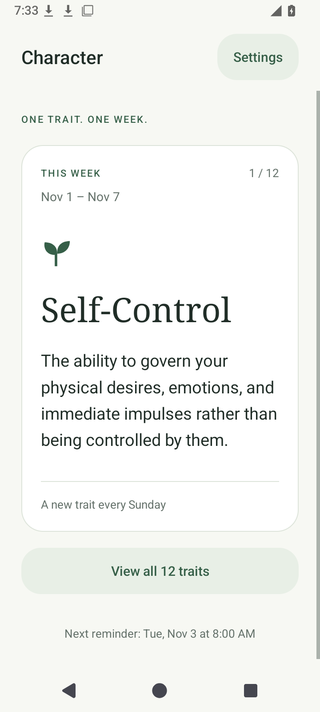
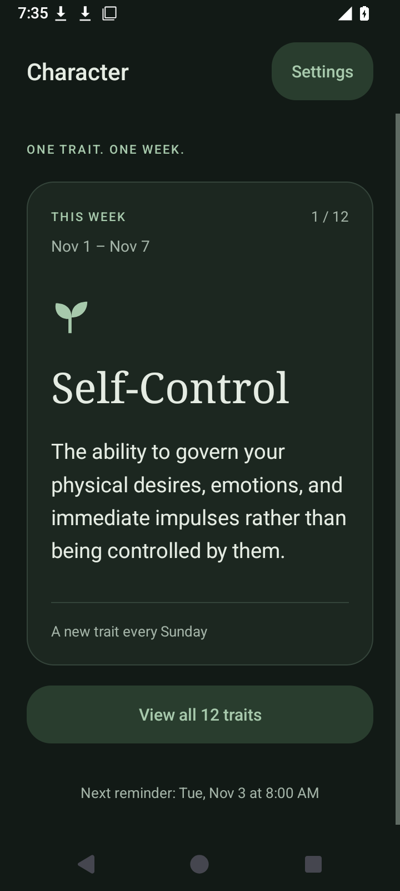
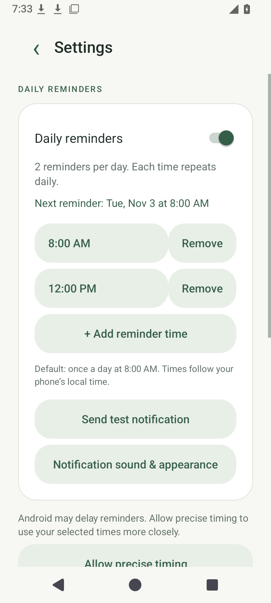
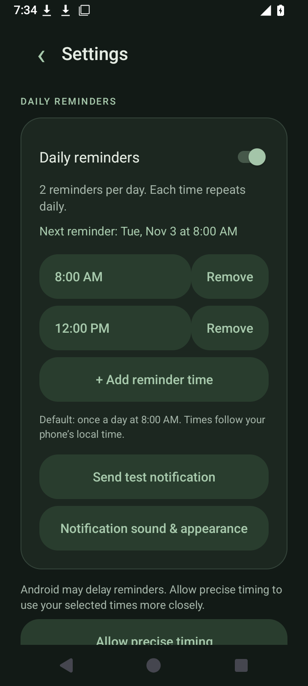

# Character

A quiet Android app for one character trait each week. Read its meaning, set daily reminders, and let the twelve-week cycle advance every Sunday.

## Install

Download **Character-1.1.0.apk** from [the latest release](https://github.com/ZohanDam/character/releases/latest) on an Android 10 or newer phone. Open the APK and allow installation from the browser or Files app if Android asks.

## Use

- **This week:** the current trait, full definition, and Sunday–Saturday dates.
- **Traits:** tap any of the twelve traits to edit its name and definition.
- **Reminders:** enable reminders, then add, change, or remove up to 24 individual daily times. The default schedule is once a day at **8:00 AM**. Reminders stay off until enabled. The next reminder and permission status appear in Settings and on the home screen. **Send test notification** previews a reminder immediately, including when daily reminders are off. **Notification sound & appearance** opens Android's settings for this channel.
- **Appearance:** follow the phone theme, or choose light or dark.
- **Backup:** export traits, daily reminder times, reminder preference, starting Sunday, and theme to a small JSON file. Import validates the complete file and asks for confirmation before replacing settings. Android's file picker controls where files are saved and opened; no storage permission is required. Imported reminders still need notification permission on the receiving phone.
- **About Character:** app description, installed version, GitHub source, and an on-demand update check. New releases download directly from GitHub to Downloads; open the downloaded APK to install.

The first week starts with Self-Control. The initial week is the Sunday–Saturday week containing first launch, so a midweek installation has a shorter first week. After Endurance, the cycle returns to Self-Control. Editing definitions does not move the cycle. Updating the installed app preserves its data; uninstalling removes local settings and edits.

The twelve traits are Self-Control, Order, Prudence, Diligence, Stewardship, Integrity, Courage, Humility, Kindness, Forgiveness (or Grace), Gratitude, and Endurance.

## Screenshots

| Light | Dark |
| --- | --- |
|  |  |
|  |  |

Screenshots are from the installed Android app. The [About screen](docs/screenshots/info-light.png) shows the version, description, and update check.

Also see the [backup controls](docs/screenshots/backup-dark.png) and [notification drawer](docs/screenshots/notification-drawer.png).

## Reminder delivery

Android 13+ requires notification permission. Settings shows a notification-permission shortcut when needed. Android 12+ may also require **Alarms & reminders** access for precise timing; without it, standard reminders still work but Android may delay delivery. Exact delivery can still be affected by device restrictions. Multiple pending times remain independent when a reminder is delivered late.

Opening the app preserves existing pending reminders, including one Android has delayed past its chosen time today. Restart, local time/timezone changes, and app updates rebuild the schedule. An Android force-stop blocks reminders until the app is opened again. Times always follow the phone's local clock. No persistent background service is used.

Drawer notifications show the trait name and an expandable definition. New reminders replace the previous entry, and the entry expires at the next Sunday midnight. The app's manual theme affects its own screens; Android controls drawer styling. Sound and vibration remain under the phone's channel settings.

Repeated update downloads recognize an active or completed download. A fresh attempt uses a unique filename so an existing APK cannot block it. **Open Downloads** opens Android's download list, where the APK can be installed.

## Privacy

Trait edits, the starting week, reminder times, and theme are stored on the device. No account, analytics, ads, or backend. Update checks contact GitHub only when requested. APK downloads are managed by Android's Download Manager. Exported backup files are readable JSON; store them in a location appropriate for their contents. See [PRIVACY.md](PRIVACY.md).

## Build

Requirements: JDK 17+, Android SDK platform 35, and build tools 36.0.0. Gradle 9.4.1 is included through the wrapper. AGP 9.2.1 provides built-in Kotlin support.

```sh
./gradlew testDebugUnitTest lintDebug assembleDebug
```

The app uses native Android views and platform APIs. There are no third-party application runtime libraries beyond the Kotlin standard library; release shrinking removes unused code. The main code separates screens, local data, date calculations, reminders, and GitHub releases.

For a signed release, set `CHARACTER_KEYSTORE`, `CHARACTER_STORE_PASSWORD`, and `CHARACTER_KEY_PASSWORD`. The keystore alias is `character`.

```sh
./gradlew testDebugUnitTest lintDebug assembleRelease
```

## Publish an update

1. Increase both `versionCode` and `versionName` in `app/build.gradle.kts`.
2. Run checks and build a release with the **same original signing key**.
3. Create a GitHub release tagged `vMAJOR.MINOR.PATCH`.
4. Upload the signed APK named exactly `Character-MAJOR.MINOR.PATCH.apk`, plus its SHA-256 checksum.

The app checks GitHub's latest stable release, compares the three numeric version components, and accepts APK links only from this repository's GitHub release-download path. Prereleases are excluded. Android enforces package/signature compatibility when installing updates. Signing credentials stay outside Git and GitHub; CI builds and tests without them.

See [1.1.0 validation results](docs/VALIDATION-1.1.0.md) for completed checks and their limits. The [1.0.1 record](docs/VALIDATION.md) is retained separately.
